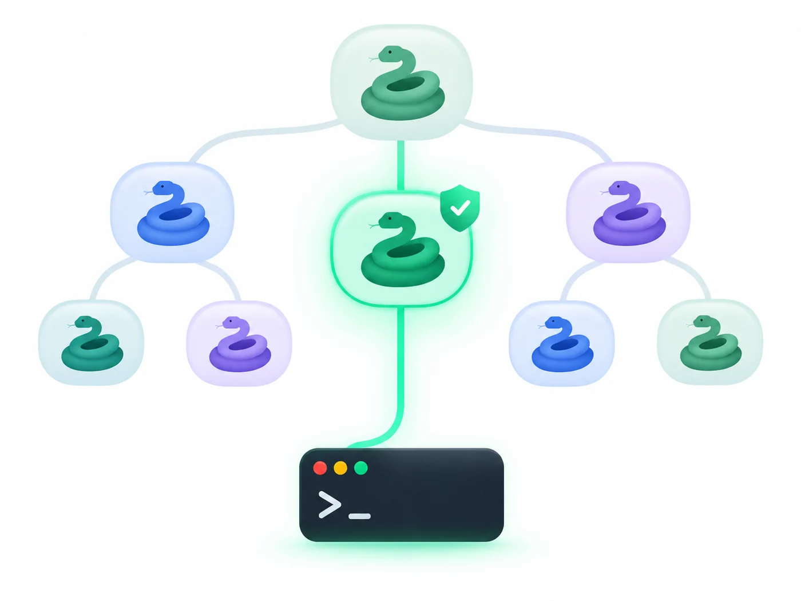
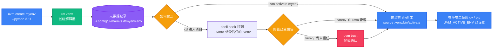

<div align="center">

# uvm

**给 `uv` 加上命名、共享的环境层——不用 conda，也能有 conda 的工作流。**

`uv` 很快，但它没有「按名字从任意目录激活一个共享环境」的概念。`uvm` 补上这一层，同时把所有 Python、虚拟环境和包操作都交给 `uv`。

[](CHANGELOG.md)
[](https://www.gnu.org/software/bash/)
[](https://docs.astral.sh/uv/)
[](#平台支持)

[](LICENSE)
[](https://github.com/Tendo33/uvm/actions/workflows/ci.yml)

[快速开始](#快速开始) · [激活机制](#激活是怎么发生的) · [命令参考](#完整命令参考) · [故障排查](#故障排查)

<sub>中文 · [English](README_en.md)</sub>



</div>

---

## 为什么用 uvm

| 任务 | 不用 uvm | 用 uvm |
| --- | --- | --- |
| 创建命名环境 | `uv venv ~/uv_envs/myenv --python 3.11` | `uvm create myenv --python 3.11` |
| 按名字激活 | `source ~/uv_envs/myenv/bin/activate` | `uvm activate myenv` |
| 按项目自动激活 | 手动 | `.uvmrc` 或受信任的 `.venv` |
| 列出所有环境 | `ls ~/uv_envs` | `uvm list` |
| 跨机器迁移环境 | 手动 | `uvm export` / `uvm import` |

uvm 不替换 `uv`。它是一层很薄的 shell 封装（`bin/` 和 `lib/` 合计约 3000 行 Bash），管理环境元数据并提供 `uv` 刻意省略的激活机制。

## 快速开始

```bash
curl -fsSL https://raw.githubusercontent.com/Tendo33/uvm/main/install.sh | bash -s -- -y
source ~/.zshrc
```

第一条命令安装并写好 shell 配置（Bash 用户改成 `source ~/.bashrc`），重新加载后 `uvm` 就能用了。然后：

```bash
uvm create myenv --python 3.11
uvm activate myenv
python -m pip install requests
uvm deactivate
```

`uvm status` 随时能看到当前激活了哪个环境、环境目录在哪、一共记录了几个环境。

## 环境要求

- Bash ≥ 3.2 或 Zsh
- [`uv`](https://docs.astral.sh/uv/)（安装脚本可以在 Linux/macOS 上帮你装）
- Linux、macOS，或装了 Git Bash 的 Windows

PowerShell 和 CMD 不支持。

## 安装

### 交互式（首次安装推荐）

```bash
curl -fsSL https://raw.githubusercontent.com/Tendo33/uvm/main/install.sh -o install.sh
bash install.sh
rm install.sh
```

Windows（Git Bash）先在 PowerShell 里装好 uv：

```bash
powershell -ExecutionPolicy ByPass -c "irm https://astral.sh/uv/install.ps1 | iex"
curl -fsSL https://raw.githubusercontent.com/Tendo33/uvm/main/install.sh -o install.sh
bash install.sh
rm install.sh
```

向导会问环境目录、要不要装 `uv`、要不要开启自动激活。

### 非交互式（CI / 脚本）

```bash
curl -fsSL https://raw.githubusercontent.com/Tendo33/uvm/main/install.sh | bash -s -- -y
curl -fsSL https://raw.githubusercontent.com/Tendo33/uvm/main/install.sh | bash -s -- -y --envs-dir /path/to/envs
curl -fsSL https://raw.githubusercontent.com/Tendo33/uvm/main/install.sh | bash -s -- -y --mirror https://pypi.tuna.tsinghua.edu.cn/simple
```

非交互模式下缺 `uv` 是硬错误。`--mirror` / `--no-mirror` 控制 PyPI 镜像，默认不配置。

安装脚本把 `uvm` 放进 `~/.local/bin`，库放进 `~/.local/lib/uvm`，配置放进 `~/.config/uvm`，并在 shell RC 里写标记块来管理 PATH 和 shell hook，所以重装和卸载都是干净的。

### 自定义环境目录

```bash
bash install.sh --envs-dir /path/to/envs
```

### 本地开发安装

```bash
git clone https://github.com/Tendo33/uvm.git
cd uvm
bash install.sh
```

### 升级

```bash
uvm update
uvm update --check
uvm update v1.2.3
```

升级后重开 shell：`exec "$SHELL"`。

## 激活是怎么发生的

`uvm` 从不自己管理解释器：每次 `create` 都走 `uv venv`，每个包操作都走 `uv pip`。它补的是围绕这些操作的环境登记和 shell 接入。



## 常用命令

覆盖日常九成的用法：

| 命令 | 作用 |
| --- | --- |
| `uvm create myenv --python 3.11` | 创建命名环境 |
| `uvm activate myenv` | 激活（需要 shell 集成） |
| `uvm deactivate` | 退出当前环境 |
| `uvm list` | 列出所有环境 |
| `uvm status` | 一眼看到当前环境与配置 |
| `uvm delete myenv` | 删除环境 |
| `uvm run myenv python -V` | 不激活直接运行命令 |

## 完整命令参考

### create

```bash
uvm create myenv
uvm create myenv --python 3.12
uvm create myenv --path /work/envs/myenv
```

改文件系统之前先校验名字。用 `--path` 创建的环境同样有元数据，会出现在 `uvm list` 里。

### activate / deactivate

```bash
uvm activate myenv
uvm deactivate
```

需要 shell 集成（在 RC 里 `eval "$(uvm shell-hook)"`，安装脚本会自动加上）。

### list

```bash
uvm list
uvm list --all
uvm list --json
```

`--all` 会多显示一列来源（managed / discovered）；`--json` 输出 JSON 数组。当前环境前面有绿色的 `*`。

### status

```bash
uvm status
uvm status --json
```

`--json` 输出形如 `{"active_env":"myenv","active_path":"...","envs_dir":"...","records":3}`。

### delete

```bash
uvm delete myenv
uvm delete myenv --force
```

拒绝删除当前激活的环境，并会清掉该路径的信任记录，之后在那里新建的 venv 不会被静默信任。

### run

```bash
uvm run myenv python my_script.py
uvm run myenv pytest tests/
```

在环境里跑命令，不改变调用它的那个 shell。

### rename

```bash
uvm rename myenv myenv-v2
```

只改登记的名字，不移动目录。当前目录树里还有 `.uvmrc` 指向旧名字时会给出警告。

### clone

```bash
uvm clone myenv myenv-copy
```

复制源环境并通过 `uv pip` 迁移包。

### export / import

```bash
uvm export myenv > requirements.txt
uvm import restored --from requirements.txt
```

走 `uv pip freeze` 和 `uv pip install`，不需要环境里预先有 `pip`。

### trust / untrust

```bash
uvm trust
uvm trust /path
uvm trust list
uvm untrust
```

本地 `.venv` 的激活脚本是可执行 shell 代码。在你显式信任它的规范路径之前，uvm 不会自动 source 它；由 uvm 管理的 `.uvmrc` 环境不需要这一步。

### update

```bash
uvm update
uvm update --check
uvm update v1.2.3
```

拒绝降级。保留 `UVM_HOME`、`UVM_ENVS_DIR` 和自动激活偏好。

### doctor

```bash
uvm doctor
```

分组显示安装健康度、shell hook 状态、当前环境、镜像配置和待处理的信任警告。出问题时先跑这个。

### repair

```bash
uvm repair
```

清理过期元数据、重扫默认环境目录、重写 shell hook 块。不会删除有效环境。

### init 与 scan

```bash
uvm init
uvm scan
uvm scan /path/to/envs
uvm register /path/to/envs
```

`uvm init` 初始化配置、配置镜像，并把默认环境目录里已有的环境登记一遍，安装后手动跑一次可以补上历史环境。`uvm scan` 和 `uvm register` 是同一个动作：把指定目录（默认 `UVM_ENVS_DIR`）下发现的虚拟环境登记进 `uvm list`，并打印登记了几个。

### config

```bash
uvm config show
uvm config get envs-dir
uvm config set envs-dir ~/my-envs
uvm config mirror set https://pypi.tuna.tsinghua.edu.cn/simple
uvm config mirror show
uvm config mirror remove
uvm config python-mirror set https://mirror.nju.edu.cn/github-release/astral-sh/python-build-standalone
uvm config python-mirror show
uvm config python-mirror remove
```

`config mirror` 管 `uv pip install` 用的 PyPI 索引，`config python-mirror` 管 uv 下载解释器用的地址，两者都写进 uv 用户级的 `uv.toml`。如果文件里已经有同类但不受管理的设置，uvm 不会改动它。

## 自动激活

在 shell RC 里加上（安装脚本会自动做）：

```bash
eval "$(uvm shell-hook)"
```

开启后，每次切换目录 uvm 都会找激活目标，优先级是：

1. 最近的、已受信任的上层 `.venv`
2. 最近的、上层 `.uvmrc`

离开项目树时会退出自动激活的环境。

### 自动激活项目里的 .venv

```bash
cd ~/project
uv venv
uvm trust
cd ~/project/src
```

### 自动激活共享的命名环境

```bash
uvm create shared-311 --python 3.11
echo "shared-311" > ~/project/.uvmrc
cd ~/project/src
```

## 配置

| 项 | 默认值 | 覆盖方式 |
| --- | --- | --- |
| `UVM_HOME` | `~/.config/uvm` | 安装前 export |
| `UVM_ENVS_DIR` | `~/uv_envs` | `uvm config set envs-dir` |
| 配置文件 | `~/.config/uvm/config` | — |
| 元数据 | `~/.config/uvm/envs.d/*.env` | — |
| uv 配置 | `~/.config/uv/uv.toml` | `XDG_CONFIG_HOME` |

配置文件是纯 `KEY="value"` 行，uvm 只解析，不执行。元数据每个环境一个文件，写 atomically（`mktemp` + `mv`）；旧版本的 `envs.json` 会迁移一次，之后不再写。

安装脚本在 shell RC 里写的是带标记的稳定块：

```bash
# >>> uvm path >>>
export PATH="${HOME}/.local/bin:$PATH"
# <<< uvm path <<<

# >>> uvm shell >>>
eval "$(uvm shell-hook)"
# <<< uvm shell <<<
```

这些标记让安装、修复、重装和卸载都是幂等的。`uv.toml` 里的镜像块同理：

```toml
# >>> uvm mirror >>>
[[index]]
url = "https://pypi.tuna.tsinghua.edu.cn/simple"
default = true
# <<< uvm mirror <<<
```

`uvm doctor` 会打印 `uv.toml` 的最终路径。`UV_DEFAULT_INDEX` 和 `UV_PYTHON_INSTALL_MIRROR` 环境变量会覆盖上面的块，`uvm config show` 会在它们被设置时提示。

## 故障排查

**`uvm: command not found`**

```bash
source ~/.zshrc
uvm doctor
```

如果 `PATH ~/.local/bin` 显示 MISSING，重跑 `bash install.sh -y`。

**`uvm activate` 提示需要 shell 集成**

```bash
uvm repair && source ~/.zshrc
```

**环境没出现在 `uvm list` 里**

```bash
uvm repair
uvm list --all
```

**自动激活不生效**

```bash
uvm doctor
uvm repair
```

**`uvm update` 之后 shell 还是旧版本**

```bash
exec "$SHELL"
```

## 平台支持

| 平台 | 状态 |
| --- | --- |
| Linux | 支持 |
| macOS | 支持 |
| Windows Git Bash | 支持（先在 PowerShell 装 uv） |
| PowerShell / CMD | 不支持 |

## 卸载

```bash
bash uninstall.sh
bash uninstall.sh --force
bash uninstall.sh --keep-shell-config
```

会移除 `~/.local/bin/uvm`、`~/.local/lib/uvm`、`UVM_HOME` 和 shell 里的标记块；你的虚拟环境和 `uv` 都保留。用了自定义 `UVM_HOME` 的话：

```bash
UVM_HOME=/custom/path bash uninstall.sh --force
```

## License

MIT，见 [LICENSE](LICENSE)。
