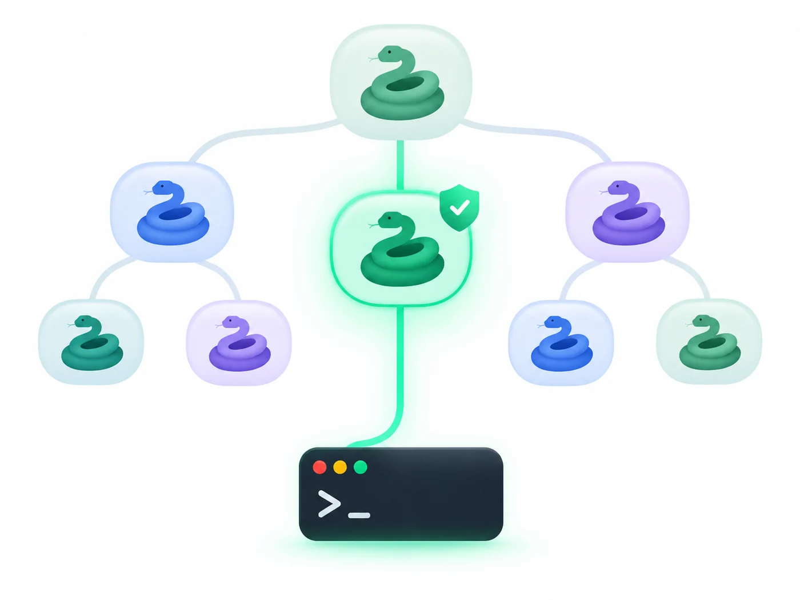

<div align="center">

# uvm

**Named, shared environments for `uv` — the conda workflow without conda.**

`uv` is fast, but it has no concept of activating a shared environment by name from any directory. `uvm` adds that layer while handing every Python, venv and package operation to `uv`.

[](CHANGELOG.md)
[](https://www.gnu.org/software/bash/)
[](https://docs.astral.sh/uv/)
[](#platform-support)

[](LICENSE)
[](https://github.com/Tendo33/uvm/actions/workflows/ci.yml)

[Quick Start](#quick-start) · [How activation works](#how-activation-works) · [Command Reference](#full-command-reference) · [Troubleshooting](#troubleshooting)

<sub>[中文](README.md) · English</sub>



</div>

---

## Why uvm

| Task | Without uvm | With uvm |
| --- | --- | --- |
| Create a named env | `uv venv ~/uv_envs/myenv --python 3.11` | `uvm create myenv --python 3.11` |
| Activate by name | `source ~/uv_envs/myenv/bin/activate` | `uvm activate myenv` |
| Auto-activate per project | manual | `.uvmrc` or a trusted `.venv` |
| List all envs | `ls ~/uv_envs` | `uvm list` |
| Move / share envs across machines | manual | `uvm export` / `uvm import` |

uvm does not replace `uv`. It is a thin shell wrapper (about 3,000 lines of Bash across `bin/` and `lib/`) that tracks environment metadata and provides the activation plumbing `uv` deliberately omits.

## Quick Start

```bash
curl -fsSL https://raw.githubusercontent.com/Tendo33/uvm/main/install.sh | bash -s -- -y
source ~/.zshrc
```

The first command installs uvm and writes your shell config (use `source ~/.bashrc` if you run Bash); after reloading, `uvm` is ready. Then:

```bash
uvm create myenv --python 3.11
uvm activate myenv
python -m pip install requests
uvm deactivate
```

`uvm status` always tells you which environment is active, where environments live and how many are recorded.

## Requirements

- Bash ≥ 3.2 or Zsh
- [`uv`](https://docs.astral.sh/uv/) (the installer can install it for you on Linux and macOS)
- Linux, macOS, or Windows with Git Bash

PowerShell and CMD are not supported.

## Installation

### Interactive (recommended for a first install)

```bash
curl -fsSL https://raw.githubusercontent.com/Tendo33/uvm/main/install.sh -o install.sh
bash install.sh
rm install.sh
```

On Windows (Git Bash), install uv in PowerShell first:

```bash
powershell -ExecutionPolicy ByPass -c "irm https://astral.sh/uv/install.ps1 | iex"
curl -fsSL https://raw.githubusercontent.com/Tendo33/uvm/main/install.sh -o install.sh
bash install.sh
rm install.sh
```

The wizard asks for the environment directory, whether to install `uv`, and whether to enable auto-activation.

### Non-interactive (CI / scripts)

```bash
curl -fsSL https://raw.githubusercontent.com/Tendo33/uvm/main/install.sh | bash -s -- -y
curl -fsSL https://raw.githubusercontent.com/Tendo33/uvm/main/install.sh | bash -s -- -y --envs-dir /path/to/envs
curl -fsSL https://raw.githubusercontent.com/Tendo33/uvm/main/install.sh | bash -s -- -y --mirror https://pypi.tuna.tsinghua.edu.cn/simple
```

In non-interactive mode a missing `uv` is a hard error. `--mirror` / `--no-mirror` control the PyPI mirror, and nothing is configured by default.

The installer puts `uvm` in `~/.local/bin`, the libraries in `~/.local/lib/uvm` and the config in `~/.config/uvm`, and writes marked blocks into your shell RC for PATH and the shell hook, so reinstalls and uninstalls stay clean.

### Custom environment directory

```bash
bash install.sh --envs-dir /path/to/envs
```

### Local development install

```bash
git clone https://github.com/Tendo33/uvm.git
cd uvm
bash install.sh
```

### Upgrade

```bash
uvm update
uvm update --check
uvm update v1.2.3
```

Reload your shell after upgrading: `exec "$SHELL"`.

## How activation works

`uvm` never manages an interpreter itself: every `create` goes through `uv venv` and every package operation through `uv pip`. What it adds is the bookkeeping and the shell integration around them.

```mermaid
flowchart LR
    A[uvm create myenv<br/>--python 3.11] --> B[uv venv<br/>creates the interpreter]
    B --> C[(Metadata record<br/>~/.config/uvm/envs.d/myenv.env)]
    C --> D{How to activate}
    D -->|uvm activate myenv| E[source .venv/bin/activate<br/>in the current shell]
    D -->|cd into a project| F[The shell hook finds<br/>.uvmrc or a trusted .venv]
    F --> G{Path trusted}
    G -->|.uvmrc, managed by uvm| E
    G -->|.venv, not yet trusted| H[uvm trust<br/>explicit opt-in]
    H --> E
    E --> I[uv / pip run inside it<br/>UVM_ACTIVE_ENV is set]

    classDef client fill:#3B82F6,stroke:#2563EB,color:#fff,stroke-width:2px
    classDef service fill:#10B981,stroke:#059669,color:#fff,stroke-width:2px
    classDef data fill:#8B5CF6,stroke:#7C3AED,color:#fff,stroke-width:2px
    classDef choice fill:#F59E0B,stroke:#D97706,color:#fff,stroke-width:2px
    classDef external fill:#F43F5E,stroke:#E11D48,color:#fff,stroke-width:2px

    class A,E,I client
    class B service
    class C data
    class D,G choice
    class H external
```



## Common Commands

These cover 90% of daily use:

| Command | What it does |
| --- | --- |
| `uvm create myenv --python 3.11` | Create a named environment |
| `uvm activate myenv` | Activate it (needs shell integration) |
| `uvm deactivate` | Leave the current environment |
| `uvm list` | List every environment |
| `uvm status` | See the active environment and config at a glance |
| `uvm delete myenv` | Delete an environment |
| `uvm run myenv python -V` | Run a command without activating |

## Full Command Reference

### create

```bash
uvm create myenv
uvm create myenv --python 3.12
uvm create myenv --path /work/envs/myenv
```

The name is validated before anything touches the filesystem. Environments created with `--path` carry metadata too and show up in `uvm list`.

### activate / deactivate

```bash
uvm activate myenv
uvm deactivate
```

Requires shell integration (`eval "$(uvm shell-hook)"` in your RC file; the installer adds it).

### list

```bash
uvm list
uvm list --all
uvm list --json
```

`--all` adds a source column (managed / discovered); `--json` prints a JSON array. The active environment is marked with a green `*`.

### status

```bash
uvm status
uvm status --json
```

`--json` prints something like `{"active_env":"myenv","active_path":"...","envs_dir":"...","records":3}`.

### delete

```bash
uvm delete myenv
uvm delete myenv --force
```

It refuses to delete the active environment and clears the trust entry for that path, so a venv created there later is not silently trusted.

### run

```bash
uvm run myenv python my_script.py
uvm run myenv pytest tests/
```

Runs a command inside the environment without changing the calling shell.

### rename

```bash
uvm rename myenv myenv-v2
```

Changes the recorded name only; the directory does not move. It warns when `.uvmrc` files in the current tree still point at the old name.

### clone

```bash
uvm clone myenv myenv-copy
```

Copies the source environment and ports the packages through `uv pip`.

### export / import

```bash
uvm export myenv > requirements.txt
uvm import restored --from requirements.txt
```

Uses `uv pip freeze` and `uv pip install`, so the environment needs no pre-installed `pip`.

### trust / untrust

```bash
uvm trust
uvm trust /path
uvm trust list
uvm untrust
```

A local `.venv` activation script is executable shell code. uvm never sources one automatically until you explicitly trust its canonical path; `.uvmrc` environments managed by uvm need no such step.

### update

```bash
uvm update
uvm update --check
uvm update v1.2.3
```

Downgrades are refused. `UVM_HOME`, `UVM_ENVS_DIR` and your auto-activation preference are preserved.

### doctor

```bash
uvm doctor
```

Groups installation health, shell hook status, the active environment, mirror config and pending trust warnings. Run it first when something is off.

### repair

```bash
uvm repair
```

Prunes stale metadata, rescans the default environment directory and rewrites the shell hook block. It does not delete valid environments.

### init and scan

```bash
uvm init
uvm scan
uvm scan /path/to/envs
uvm register /path/to/envs
```

`uvm init` initialises the config, sets up the mirror and registers whatever it finds in the default environment directory, which is useful for picking up environments that predate the install. `uvm scan` and `uvm register` are the same action: register the environments found under a directory (default `UVM_ENVS_DIR`) into `uvm list`, and print how many were added.

### config

```bash
uvm config show
uvm config get envs-dir
uvm config set envs-dir ~/my-envs
uvm config mirror set https://pypi.tuna.tsinghua.edu.cn/simple
uvm config mirror show
uvm config mirror remove
uvm config python-mirror set https://mirror.nju.edu.cn/github-release/astral-sh/python-build-standalone
uvm config python-mirror show
uvm config python-mirror remove
```

`config mirror` manages the PyPI index `uv pip install` uses and `config python-mirror` the URL uv downloads interpreters from; both are written to uv's user-level `uv.toml`. If an unmanaged setting of the same kind already exists there, uvm leaves it alone.

## More examples

Longer walkthroughs of switching between environments, mirror setup and CI use live in [docs/EXAMPLES.md](docs/EXAMPLES.md).

## Auto-Activation

Add this to your shell RC (the installer does it for you):

```bash
eval "$(uvm shell-hook)"
```

Once enabled, every directory change looks for a target to activate, in this order:

1. The nearest trusted parent `.venv`
2. The nearest parent `.uvmrc`

Leaving the project tree deactivates whatever was auto-activated.

### Auto-activate a project .venv

```bash
cd ~/project
uv venv
uvm trust
cd ~/project/src
```

### Auto-activate a shared named environment

```bash
uvm create shared-311 --python 3.11
echo "shared-311" > ~/project/.uvmrc
cd ~/project/src
```

## Configuration

| Item | Default | Override |
| --- | --- | --- |
| `UVM_HOME` | `~/.config/uvm` | export before installing |
| `UVM_ENVS_DIR` | `~/uv_envs` | `uvm config set envs-dir` |
| Config file | `~/.config/uvm/config` | — |
| Metadata | `~/.config/uvm/envs.d/*.env` | — |
| uv config | `~/.config/uv/uv.toml` | `XDG_CONFIG_HOME` |

The config file is plain `KEY="value"` lines; uvm parses them and never executes them. Metadata is one file per environment, written atomically (`mktemp` + `mv`); an `envs.json` from older versions is migrated once and never written again.

The installer writes stable marked blocks into your shell RC:

```bash
# >>> uvm path >>>
export PATH="${HOME}/.local/bin:$PATH"
# <<< uvm path <<<

# >>> uvm shell >>>
eval "$(uvm shell-hook)"
# <<< uvm shell <<<
```

Those markers make install, repair, reinstall and uninstall idempotent. The mirror block in `uv.toml` follows the same pattern:

```toml
# >>> uvm mirror >>>
[[index]]
url = "https://pypi.tuna.tsinghua.edu.cn/simple"
default = true
# <<< uvm mirror <<<
```

`uvm doctor` prints the resolved `uv.toml` path. The `UV_DEFAULT_INDEX` and `UV_PYTHON_INSTALL_MIRROR` environment variables override these blocks, and `uvm config show` says so when they are set.

## Troubleshooting

**`uvm: command not found`**

```bash
source ~/.zshrc
uvm doctor
```

If `PATH ~/.local/bin` shows MISSING, re-run `bash install.sh -y`.

**`uvm activate` says shell integration is required**

```bash
uvm repair && source ~/.zshrc
```

**An environment is missing from `uvm list`**

```bash
uvm repair
uvm list --all
```

**Auto-activation does not work**

```bash
uvm doctor
uvm repair
```

**The shell still shows the old version after `uvm update`**

```bash
exec "$SHELL"
```

## Platform Support

| Platform | Status |
| --- | --- |
| Linux | Supported |
| macOS | Supported |
| Windows Git Bash | Supported (install uv in PowerShell first) |
| PowerShell / CMD | Not supported |

## Uninstall

```bash
bash uninstall.sh
bash uninstall.sh --force
bash uninstall.sh --keep-shell-config
```

This removes `~/.local/bin/uvm`, `~/.local/lib/uvm`, `UVM_HOME` and the marked blocks in your shell; your virtual environments and `uv` are kept. With a custom `UVM_HOME`:

```bash
UVM_HOME=/custom/path bash uninstall.sh --force
```

## License

MIT, see [LICENSE](LICENSE).
